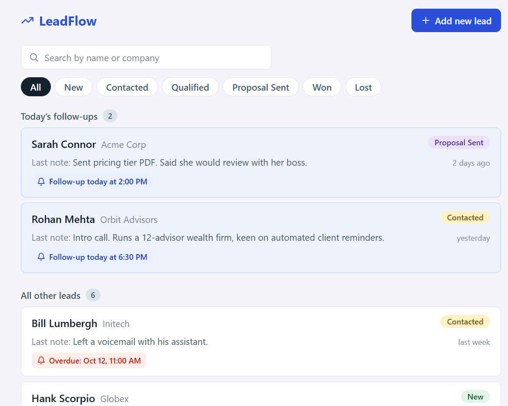
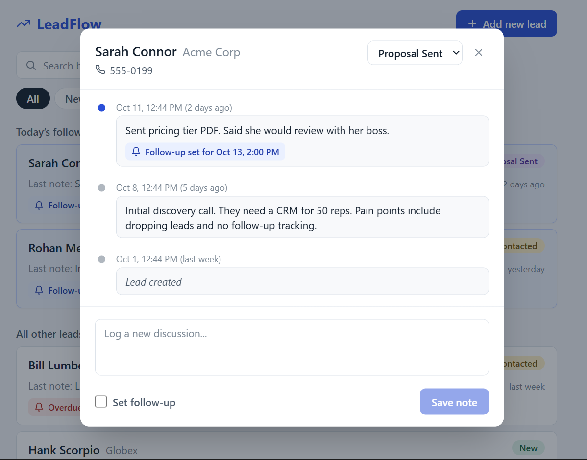
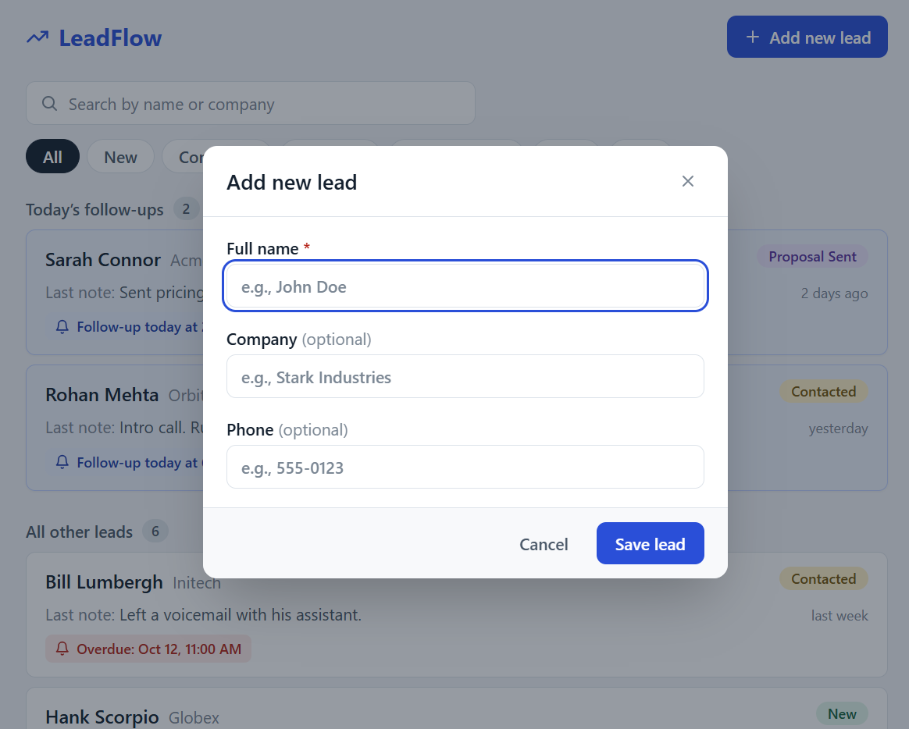
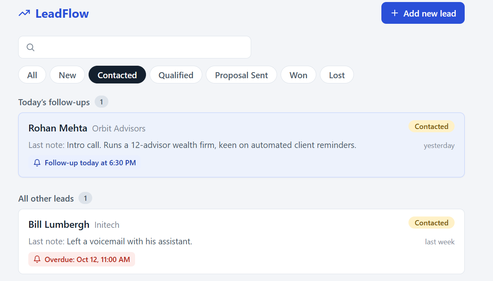

# LeadFlow

A single-screen lead management tool: track leads, log every discussion, and set follow-up reminders.

**Stack:** Next.js 15 (App Router, TypeScript, Tailwind, TanStack Query, Radix Dialog) · FastAPI · SQLAlchemy 2 · SQLite

## Demo

Video walkthrough (about 1 min): [Watch the demo](https://drive.google.com/file/d/1KPoY3_9l48kiR8_Rbx1yBFFWp9rNlpxP/view?usp=sharing)

| Lead list | Lead timeline dialog |
| --- | --- |
|  |  |

| Add new lead | Filter and search |
| --- | --- |
|  |  |

## Features

- Lead list with name, status badge, last note and "time ago"
- Status filter (All / New / Contacted / Qualified / Proposal Sent / Won / Lost) and search by name or company
- Today's follow-ups pinned at the top; overdue follow-ups highlighted in red and listed first
- Click a lead to open a dialog with the full discussion timeline (newest first), a form to log a note with an optional follow-up date and time, and a status dropdown. Changes show up in the list straight away
- Add new lead (name required; company and phone optional; status defaults to New)
- Seed script with 8 leads and discussions, including one overdue follow-up and two due today

## Setup

You need Python 3.11+ and Node 20+. Run the backend and frontend in two separate terminals, starting from the repository root.

### Backend (http://localhost:8000)

**Windows (PowerShell)**

```powershell
cd backend
python -m venv .venv
.venv\Scripts\Activate.ps1
pip install -r requirements-dev.txt
copy ..\.env.example .env
python -m app.seed
uvicorn app.main:app --reload
```

If PowerShell blocks the activate script, run `Set-ExecutionPolicy -Scope CurrentUser RemoteSigned` once and try again.

**macOS / Linux**

```bash
cd backend
python3 -m venv .venv && source .venv/bin/activate
pip install -r requirements-dev.txt
cp ../.env.example .env
python -m app.seed
uvicorn app.main:app --reload
```

`python -m app.seed` is safe to re-run: it does nothing if leads already exist. Use `python -m app.seed --reset` to wipe and re-seed. API docs are at http://localhost:8000/docs.

### Frontend (http://localhost:3000)

**Windows (PowerShell)**

```powershell
cd frontend
copy ..\.env.example .env.local
npm install
npm run dev
```

**macOS / Linux**

```bash
cd frontend
cp ../.env.example .env.local
npm install
npm run dev
```

Open http://localhost:3000.

### Environment variables

See [`.env.example`](.env.example). Backend: `DATABASE_URL`, `CORS_ORIGINS`, `SEED_TIMEZONE` (the timezone the seed script uses to decide what "today" is). Frontend: `NEXT_PUBLIC_API_URL`.

### Tests

```bash
cd backend && pytest        # API, validation, follow-up rules, seed data
cd frontend && npm test     # today / overdue classification, date handling
cd frontend && npm run lint # type check (tsc --noEmit)
```

Last run: 23 backend tests and 8 frontend tests pass, and the type check reports no errors.

### Docker Compose (optional, not tested)

`docker-compose.yml` and Dockerfiles for both services are included, but I have not been able to test them, so use the manual setup above. If you have Docker, this should start everything:

```bash
docker compose up --build
```

## API

| Method | Path | Description |
| ------ | ---- | ----------- |
| GET | `/leads?status=&q=` | List leads with `last_note` / `last_discussion_at`. `q` searches name and company (case-insensitive). |
| POST | `/leads` | Create a lead (`name` required; status defaults to `New`). **201** |
| GET | `/leads/{id}` | One lead |
| PATCH | `/leads/{id}` | Partial update, e.g. `{"status": "Won"}` |
| GET | `/leads/{id}/discussions` | Full history, newest first |
| POST | `/leads/{id}/discussions` | Log a note with optional `follow_up_at`. **201** |

Errors always return `{"detail": "..."}`: **404** unknown lead, **422** validation (plus an `errors: [{field, message}]` list), **500** unexpected.

## Project structure

```
backend/
  app/
    main.py        app setup, CORS, routers
    models.py      Lead and Discussion tables
    schemas.py     request/response models and validation
    crud.py        database operations and business rules
    routers/       leads.py, discussions.py
    errors.py      consistent error responses
    seed.py        demo data
  tests/
frontend/src/
  app/             Next.js page, layout, providers
  components/      LeadList, LeadCard, LeadDialog, DiscussionTimeline, DiscussionForm, AddLeadDialog, ...
  hooks/           data fetching and mutations (TanStack Query)
  lib/             API client, follow-up / date logic (unit-tested)
```

## Design decisions

- **Timezones.** Timestamps are stored and returned in UTC. `follow_up_at` must include an offset or `Z` (naive values get a 422). "Today" and "overdue" are decided in the browser using the user's local calendar day. A follow-up earlier today stays pinned (and turns red) rather than silently becoming "overdue".
- **Follow-ups.** Saving a discussion sets the lead's `follow_up_at` to the value sent, or clears it when none is sent, because logging a discussion means the previous follow-up was handled. The note and follow-up are saved in one transaction.
- **Last note.** The most recent note written by the rep. System entries ("Lead created", "Status changed ...") are only a fallback, so a status change never hides the real last conversation. The list is a single SQL query (no N+1).
- **System entries.** Creating a lead or changing its status adds an italic `is_system` entry to the timeline.
- **Updating the list.** Mutations invalidate the TanStack Query cache, and the new note is also inserted into the timeline immediately. The open dialog reads its own lead query, so changing a status that no longer matches the active filter doesn't break it.
- **Schema setup.** Tables are created on startup. A migration tool (Alembic) would replace this in production.

## Known limitations

No login (optional in the brief), no pagination, no editing or deleting of leads and notes, and SQLite only.

## AI usage

I used Claude (Anthropic) as a coding assistant for this assessment, as the brief encouraged.

**Generated by Claude**

- The architecture and API design (endpoints, data model, error format)
- The FastAPI backend: models, schemas, routes, validation and error handling
- The backend tests (pytest), the seed script and the Docker files
- The Next.js frontend: components, data-fetching hooks, follow-up / overdue logic and its unit tests (Vitest)
- First drafts of this README and `.env.example`
- The seed data (names, companies and notes are fictional)

**How the output was checked**

- Claude ran the backend tests, the frontend tests and an automated browser test of the main flow (add a lead, log a note with a follow-up, change status, filter, search).
- I also ran the backend tests (23 passing), the frontend tests (8 passing) and the type check myself on Windows.
- The Docker setup was not tested by Claude or by me.

**What I did myself**

- Ran the backend and frontend locally on Windows and tested the app in the browser.
- Set up the Git repository and commit history, and published it to GitHub.
- Reviewed the code and can explain the main decisions: the single-query lead list in `crud.py`, the local-timezone follow-up logic in `lib/followups.ts`, and the cache updates in `hooks/useLeads.ts`.
